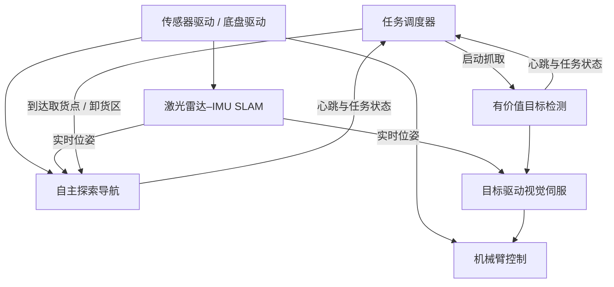

# IRMV“月极巡拓者”技术路线总结与复刻建议

> 分析对象：上海交通大学 IRMV“月极巡拓者”团队比赛项目推文  
> 原文日期：2025 年 10 月 31 日  
> 原文链接：[微信公众号推文](https://mp.weixin.qq.com/s?__biz=MzkzNDg5NjczNQ==&mid=2247483859&idx=1&sn=e2c7b63b220162cd613dfa59c8460f09)  
> 文档用途：团队技术学习、方案复刻与后续改良参考

## 1. 核心结论

该项目不是简单的“导航车 + 机械臂”，而是一套完整的移动操作机器人系统，围绕以下任务闭环展开：

```text
启动
→ 激光 SLAM 定位与建图
→ 未知环境自主探索
→ 发现取货区和目标物
→ 目标识别、分割与三维定位
→ 车体视觉伺服对准
→ 机械臂抓取
→ 运输至卸货区
→ 精确卸货
→ 自主返回起点
```

系统包含三个主要算法模块：

1. 激光雷达–IMU 紧耦合 SLAM；
2. 未知环境自主探索导航；
3. YOLO11 + SAM2 + 深度点云 + PCA + 三级视觉伺服抓取。

其核心工程思想是：

- 用不依赖环境光的激光雷达保证全局定位和几何感知；
- 用视觉模型完成目标语义识别；
- 用深度点云和 PCA 计算目标三维位置及朝向；
- 先控制履带底盘对准目标，再让低自由度机械臂执行抓取；
- 用柔性夹爪吸收剩余的定位、姿态和控制误差。

## 2. 比赛任务与环境约束

比赛模拟月球极区（纬度 80°以上）未知地表环境，机器人需要完全自主完成启动、导航、目标抓取、运输、卸货及返航。

主要技术困难包括：

- 地图和障碍物完全未知；
- 低照度、长阴影导致视觉特征稀疏；
- 存在岩石等正障碍和陨石坑等负障碍；
- 履带底盘在松软地形上存在打滑；
- 需要在移动底座上完成高精度抓取；
- 平台尺寸、重量和边缘计算能力受限。

## 3. 系统总体架构

推文技术路线图展示的模块关系如下：



任务调度器负责切换导航、搜索、对准、抓取、运输、卸货和返航状态。导航模块和抓取模块都向调度器发送“心跳”，说明系统可能包含模块存活检测、状态反馈或看门狗机制。

推荐复刻时采用明确的任务状态机：

```text
INIT
→ EXPLORE_TO_PICKUP
→ SEARCH_TARGET
→ ALIGN_TARGET
→ GRASP
→ VERIFY_GRASP
→ NAVIGATE_TO_DROPOFF
→ ALIGN_DROPOFF
→ RELEASE
→ RETURN_HOME
→ FINISHED
```

每个状态都应包含超时、重试、故障恢复和安全退出。

## 4. 激光雷达–IMU 紧耦合 SLAM

### 4.1 推文明确信息

- 使用激光雷达–IMU 紧耦合 SLAM；
- 融合退化检测机制；
- 使用因子图优化；
- 抑制稀疏、复杂月面地貌中的定位漂移；
- 实现全局一致的高精度建图与实时定位；
- SLAM 位姿同时提供给导航和目标伺服模块；
- 展示了三维点云、累计轨迹及类似高程图的地图结果。

### 4.2 工程理解

履带底盘在转向及松软地面上容易打滑，因此轮式里程计只能作为辅助信息。以 LiDAR–IMU 为主要定位源能够降低低照度和履带滑移的影响。

“退化检测”可能用于识别平坦地面、长走廊或点云稀疏环境中某些方向约束不足的情况，例如检测优化问题的信息矩阵或 Hessian 特征值。但推文没有公开具体判据。

### 4.3 尚未公开

- 具体使用 FAST-LIO2、LIO-SAM 还是其他 SLAM；
- IMU 型号、安装位置和采样频率；
- LiDAR–IMU 时间同步与外参标定方式；
- 点云运动畸变补偿；
- 退化检测算法；
- 因子图包含的因子；
- 是否使用回环检测；
- 地图分辨率、运行频率和漂移指标。

因此不能根据推文直接断定其具体 SLAM 工程。

## 5. 未知环境自主探索与导航

### 5.1 推文明确信息

- 根据实时障碍信息进行自主探索；
- 使用动态路径规划；
- 增量式更新环境地图；
- 在完全未知环境中主动搜索任务区域；
- 规避陨石坑、岩石以及文中所称的动态或静态障碍；
- 在取货点、卸货点和起点之间自主往返。

### 5.2 尚未公开

- 探索目标如何选择；
- 是否采用前沿探索；
- 全局及局部规划器类型；
- 使用二维占据栅格、高程图还是三维体素地图；
- 陨石坑等负障碍的检测方式；
- 地形坡度、台阶和可通行性阈值；
- 履带底盘运动学与滑移补偿；
- 目标点坐标是否预先给定。

### 5.3 建议改良

普通二维障碍栅格主要处理凸出地面的岩石，难以可靠表示坑洞。建议导航地图至少包含：

- 地面高程；
- 局部坡度；
- 高程突变；
- 点云稀疏或未知区域；
- 车体宽度和履带接地范围；
- 地形可通行概率；
- 正障碍和负障碍的独立风险项。

这与推文中团队未来规划的“地形可通行性概率建模与预测”方向一致。

## 6. 目标感知与三维定位

### 6.1 完整感知链路

```text
RGB 图像
→ 图像预处理
→ YOLO11 目标检测
→ SAM2 精细分割

SAM2 掩膜 + 深度图
→ 深度像素筛选
→ 相机模型反投影
→ 相机坐标系目标点云
→ 相机到车体坐标变换
→ 车体坐标系目标点云
→ PCA 主成分分析
→ 有向包围框 OBB
→ 目标中心、方向和抓取点
```

具体作用如下：

1. YOLO11 获得目标类别和二维检测框；
2. SAM2 在检测区域内获得更精确的目标掩膜；
3. 根据掩膜从深度图提取目标像素；
4. 利用相机内参将像素反投影为三维点；
5. 利用相机–车体外参将点云变换到车体坐标系；
6. 对目标点云进行 PCA，得到目标主轴；
7. 构造 OBB，获得目标中心、尺寸和方向；
8. 将结果发送给车体视觉伺服和机械臂控制。

### 6.2 目标类别

图片中可见的训练和测试对象包括：

- 不同颜色的立方体；
- 棱柱或托盘状物；
- 不规则岩石；
- 类似黏土、石块的自然物体；
- 不同颜色、形状和材质的组合。

模型标签截图中出现 cube、prism、rock、clay 等类别。

### 6.3 PCA 的风险

PCA 适合长方体、棱柱等具有明显主方向的物体，但存在以下问题：

- 正方体各方向方差相近，主轴容易跳变；
- 圆形、球形物体不存在稳定朝向；
- 单视角点云不完整时，中心和方向会偏移；
- 深度空洞、地面点和离群点会污染结果；
- 主轴具有 180°方向歧义。

复刻时建议在 PCA 前加入：

- 深度有效性检查；
- 统计或半径离群点去除；
- 地面平面剔除；
- 点云连通域筛选；
- 最小点数阈值；
- PCA 特征值置信度判断；
- 对称物体降级策略；
- 多帧位置及方向滤波。

## 7. 数据集、仿真与模型部署

推文公开的数据构建路线为：

1. 使用 TRELLIS 重建三维物体；
2. 将三维资产导入 Isaac Sim；
3. 生成大规模仿真数据用于预训练；
4. 采集多种光照条件下的真实样本；
5. 到比赛现场采集数据并继续微调；
6. 进行亮度和几何数据增强；
7. 最终得到 5000+ 组数据；
8. 对 YOLO + SAM 网络进行轻量化和嵌入式部署。

“5000+组数据”包含仿真和增强数据，不代表采集了 5000 组完全独立的真实现场数据。

建议自建数据集按以下维度分层：

- 正常光、弱光、局部强光、长阴影；
- 顺光、逆光和侧光；
- 单目标、多目标及相互遮挡；
- 不同距离、视角和旋转角；
- 不同地面纹理；
- 运动模糊和曝光变化；
- 深度空洞和红外干扰；
- 车体或夹爪遮挡目标；
- 目标位于图像边缘；
- 仿真、实验室和比赛现场三个数据域。

推文没有公开模型剪枝、量化、蒸馏方法、训练超参数或嵌入式运行帧率。

## 8. 视觉伺服与抓取控制

推文明示的控制顺序为：

```text
角度 PID 粗控
→ 平移 PID 精控
→ 角度 PID 精控
→ 机械臂抓取
```

结合系统框图判断，这三级 PID 主要用于车体抓取前对准：

1. 根据目标相对位置大幅调整车体朝向；
2. 控制履带前后移动或小幅转向，使目标进入机械臂工作空间；
3. 精调车体航向，使夹爪方向与目标主轴匹配；
4. 车体停止并等待稳定；
5. 机械臂执行预设或逆解得到的抓取轨迹；
6. 柔性夹爪闭合。

复刻时应加入：

- PID 输出限幅；
- 积分抗饱和；
- 误差死区；
- 履带静摩擦补偿；
- 接近目标时分段降速；
- 连续多帧稳定后才切换控制阶段；
- 目标丢失时立即停止并重新搜索；
- 车体制动稳定后再启动机械臂；
- 夹爪电流、位置或视觉复检等抓取确认机制。

## 9. 硬件平台

### 9.1 整体配置

- 履带式移动底盘；
- 四自由度机械臂；
- 自适应柔性夹爪；
- 储物与卸载装置；
- Livox Mid360 激光雷达；
- 奥比中光 Gemini 2 深度相机；
- 移动端计算、驱动和控制模块。

整机图标注尺寸为 `321 × 302 × 315`。图中没有显示单位，按机械图习惯可能是毫米，但需要进一步确认。

### 9.2 履带底盘

结构图展示了：

- 主动轮；
- 从动轮；
- 多个支重轮；
- 电机；
- 履带；
- 弹簧悬架或张紧机构。

履带能提升松软、颗粒地形的通过性，但转向滑移较大，不应过度依赖履带里程计。

### 9.3 四自由度机械臂与夹爪

图中标出四个关节，部分连杆尺寸约为：

- `105`；
- `97.5`；
- `54`。

夹爪参数约为：

- 开口范围 `0–90`；
- 夹爪宽度 `45`；
- 软、硬接触结构结合；
- 带辅助夹持结构；
- 能通过柔性结构适应不同形状和尺寸的物体。

上述尺寸均未在图片中标注单位。

柔性夹爪是系统的重要容错设计，可以降低目标定位、车体对准和机械臂重复定位精度的要求。

### 9.4 储物与卸载装置

结构图标出了：

- 顶部相关尺寸 `127`；
- 高度相关尺寸 `147`；
- 宽度 `124`；
- 底面约 `20°` 倾角；
- 斗体和斗门。

从结构判断，可能通过倾斜底面和斗门实现重力卸料，但斗门驱动方式未公开。

### 9.5 传感器分工

Gemini 2：

- RGB 图像输入；
- 双目/结构光深度估计；
- 近距离导航障碍检测；
- 抓取目标识别和三维定位。

Livox Mid360：

- 三维激光点云输入；
- 定位与建图；
- 导航障碍物检测。

实机图片中还能看到疑似补光装置，但推文没有公开型号、功率或控制方法，不能视为已确认配置。

## 10. 实验结果与证据强度

推文公开的量化结果包括：

| 指标 | 公开结果 | 解读 |
|---|---:|---|
| 充足光照抓取 | 4/4 | 演示样本全部成功，但样本量很小 |
| 微弱光照抓取 | 4/4 | 证明低照度闭环可以运行，不等于统计成功率为 100% |
| 位置误差 | `< 2 cm` | 推测为伺服抓取对准误差，测量方法未公开 |
| 角度误差 | `约 1.5°` | 未给出均值、方差或最大误差口径 |
| 系统闭环 | 取货—抓取—运输—卸货—返航 | 说明完整任务流程已经跑通 |

推文没有公开：

- SLAM 漂移；
- 导航成功率；
- 单次任务时间；
- 抓取大样本成功率；
- 误差均值和方差；
- 电池续航；
- 不同地形条件下的统计结果；
- 失败案例。

因此其成熟度可以表述为“完整闭环已经跑通”，不能据此认为所有模块都经过了充分统计验证。

## 11. 推荐复刻顺序

### 阶段一：目标感知台架

- 完成 Gemini 2 内参标定；
- 完成相机到车体坐标系外参标定；
- 训练并部署 YOLO11；
- 在 YOLO 检测框内调用 SAM2；
- 完成深度反投影、点云过滤、PCA 和 OBB；
- 输出目标在车体坐标系下的 `(x, y, z, yaw)`。

建议验收目标：静态条件下位置误差小于 2 cm，方向误差小于 2°。

### 阶段二：车体视觉伺服

- 暂时不接机械臂；
- 实现角度粗调、平移精调和角度精调；
- 加入目标丢失、超时和重新搜索；
- 测试不同初始距离和方向下的对准成功率。

### 阶段三：机械臂与柔性夹爪

- 完成四自由度机械臂正逆运动学；
- 建立车体对准后的固定抓取轨迹；
- 测试不同尺寸和形状物体；
- 增加抓取成功确认。

### 阶段四：定位与导航

- 完成 Mid360–IMU 标定和时间同步；
- 跑通激光惯性里程计；
- 建立障碍地图；
- 先实现已知地图导航；
- 再增加未知环境探索与增量地图更新。

### 阶段五：全流程调度

- 建立任务状态机；
- 加入心跳、超时和重试；
- 接入取货、卸货和返航；
- 完成日志记录和离线回放。

### 阶段六：低照度与现场适配

- 生成 Isaac Sim 合成数据；
- 采集实验室多光照数据；
- 使用少量现场数据微调；
- 对所有任务节点进行重复试验；
- 分模块统计成功率、耗时和失败原因。

## 12. 优先改良方向

1. SAM2 只在目标 ROI 和抓取阶段运行，或采用异步低频分割，降低边缘算力压力。
2. 为 PCA 加入特征值置信度、对称物体降级策略和多帧方向连续性约束。
3. 在导航地图中增加高程、坡度、负障碍和地形可通行概率。
4. 加入抓取后闭环验证，避免机器人空载进入运输状态。
5. 对目标三维位置和方向进行多帧滤波，减少 PID 抖动。
6. 为状态机设计目标丢失、导航卡死、SLAM 退化和模块无响应恢复流程。
7. 按光照、物体、遮挡、初始位姿和地形分组统计成功率。
8. 将 SAM2、PCA、规划和地图更新拆成不同运行频率，进行算力调度。
9. 增加传感器健康检查和数据时间戳监控。
10. 保存完整 rosbag/运行日志和失败现场，支持离线回放。

## 13. 定向学习清单

### 定位建图

- SE(3) 位姿表示和坐标变换；
- 点云配准；
- IMU 预积分；
- 激光雷达–IMU 紧耦合；
- 退化检测；
- 因子图优化。

### 标定与同步

- 相机内参；
- 相机–车体外参；
- LiDAR–IMU 外参；
- 时间戳同步；
- 点云运动畸变补偿。

### 导航与探索

- 二维占据地图和高程地图；
- 地面分割和负障碍；
- 前沿探索；
- 全局路径规划；
- 局部避障；
- 地形可通行性建模。

### 三维目标感知

- 目标检测与实例分割；
- 深度相机模型；
- 深度反投影；
- 点云过滤；
- PCA 和 OBB；
- 抓取点生成。

### 移动操作

- 履带差速控制；
- 视觉伺服；
- PID 控制；
- 机械臂正逆运动学；
- 轨迹规划；
- 柔性夹爪和顺应控制。

### 数据与部署

- Isaac Sim；
- Sim-to-Real；
- 数据增强；
- 现场微调；
- 模型剪枝、量化和加速；
- 边缘平台性能分析。

### 系统工程

- 任务状态机；
- 心跳和看门狗；
- 故障恢复；
- 日志与数据回放；
- 自动化测试；
- 统计验收。

## 14. 推文尚未公开的信息

后续必须自行选型或通过其他资料补齐：

- 主控计算平台及 GPU 型号；
- 操作系统、中间件和软件架构；
- SLAM 具体工程及参数；
- IMU 型号；
- 电机、编码器和驱动器；
- 机械臂舵机、减速比、负载和重复定位精度；
- 底盘速度闭环方法；
- 探索、全局规划和局部规划算法；
- 数据集标注规范及训练超参数；
- SAM2 轻量化方法；
- 机械臂轨迹规划或逆解方法；
- 夹爪反馈和斗门驱动方式；
- 电池、供电、续航和热管理；
- 软件接口与通信协议。

## 15. 复刻边界

仅凭该推文，可以较可靠地复刻：

- 系统总体结构；
- 模块功能划分；
- 传感器分工；
- 主要算法链路；
- 感知与抓取流程；
- 数据构建思路；
- 分阶段集成方法。

不能仅凭推文一比一复刻：

- 源代码；
- 精确硬件型号；
- 标定参数；
- 控制参数；
- 模型权重；
- 训练超参数；
- 具体规划和 SLAM 实现。

最合理的策略是先模仿其系统分解和算法链路，建立可运行的最小闭环，再用本团队的硬件、数据和测试结果逐步替换未知实现。

